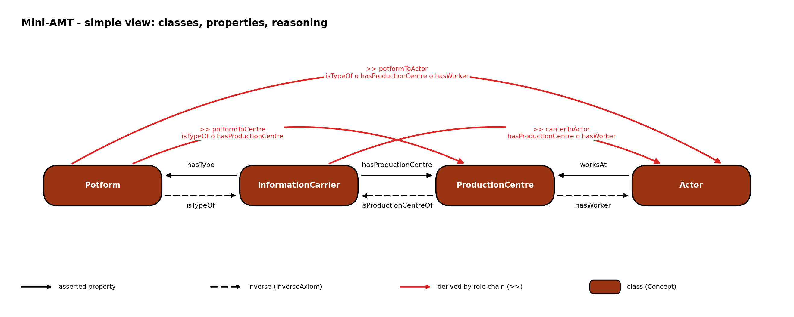

# mini-amt

A deliberately small AMT domain model for the chain

    [Potform] -- [InformationCarrier] -- [ProductionCentre] -- [Actor]

and the role-chain reasoning on top of it, documented as GitHub Pages in `docs/`.
It is about the **model and its reasoning only**: no concrete instances, no real
URIs, no degree calculation yet. This repository is laid out (`main.py`, `py/`,
`ontology/`, `data/`, `docs/`) so that it can move into `CHNT2026-amt` as it is.

## The model in one table

| Layer | What | Names |
|---|---|---|
| Concepts | four classes | `Potform`, `InformationCarrier`, `ProductionCentre`, `Actor` |
| Asserted roles | direction of the source data | `hasType` (IC -> Potform), `hasProductionCentre` (IC -> PC), `worksAt` (Actor -> PC) |
| Inverse roles | `amt:InverseAxiom` | `isTypeOf`, `isProductionCentreOf`, `hasWorker` |
| Derived roles (`>>`) | `amt:RoleChainAxiom` | `potformToCentre`, `carrierToActor`, `potformToActor` |
| Derived inverses (`<<`) | `amt:InverseAxiom` | `centreToPotform`, `actorToCarrier`, `actorToPotform` |
| Generic `>>` / `<<` | `amt:SubsumptionAxiom` + inverse | `reaches`, `reachedBy` |

The three rules, as role chains over the roles that point along the chain direction:

    [Potform]>>[ProductionCentre]              = isTypeOf o hasProductionCentre
    [InformationCarrier]>>[Actor]              = hasProductionCentre o hasWorker
    [Potform]>>[Actor]                         = isTypeOf o hasProductionCentre o hasWorker

Two of the three asserted roles point against the chain direction, so every rule
needs at least one inverse. `hasType` / `isTypeOf` was agreed with Allard Mees.
Every role carries a `skos:definition` and a `skos:scopeNote` in the ontology; the
documentation is generated from them.

## Weights and direction

An inverse edge carries the **same** `amt:weight` as its antecedent (the AMT
`InverseRule` copies it), because the weight is the degree of the statement and an
inverse is the same statement read from the other end. All AMT operators are
symmetric, so a derived `>>` and its `<<` carry the same degree too. Shares,
frequencies and normalised alternatives are directional and do not belong in
`amt:weight`. Details: `docs/weights.md`.

## Run

Windows `cmd`, from the repository root:

    pip install -r requirements.txt

    python main.py

`python main.py --list` shows the steps (`reason`, `diagrams`, `docs`),
`--only docs` runs one. Output goes to `dist/` (reasoning) and `docs/` (figures and
pages) and is byte-identical from run to run. `docs/` is committed because GitHub
Pages serves it; set Pages to "Deploy from a branch", folder `/docs`.

The `reason` step uses an independent reference reasoner (`py/reference_reasoner.py`,
about sixty lines). If the AMT engine is importable
(`pip install git+https://github.com/n4o-rse/amt-engine.git`), the same step also
runs the engine on `dist/mini-amt-with-toy.ttl` and fails if the two disagree on
any edge or weight.

## Placeholders

* The namespace `mini:` (`http://example.org/mini-amt/`) is not a real IRI.
* The documentation links to the planned home `leiza-scit/CHNT2026-amt`
  (`REPO` in `py/docs_text.py`).
* `amt:logic` of the three role chains is `amt:GoedelLogic` as a placeholder.
  The degree of connection is decided later; it only needs a change of those
  three triples. The toy weights (0.9 / 0.6 / 0.8) are arbitrary.
* Role names other than `hasType` / `isTypeOf` are proposals.
* The source model's `ActorEntity` and `Actor` are collapsed into `Actor`.

## Layout

    main.py                    orchestrator (--list, --only, --dry-run)
    requirements.txt
    CHANGELOG.md
    ontology/mini-amt.ttl      the domain model, no instances
    data/toy-chain.ttl         one abstract individual per concept
    py/                        utils, reference_reasoner, diagram_kit, docs_text, step_*
    docs/                      GitHub Pages: Jekyll shell (source), pages and diagrams (generated)
    dist/                      reasoning output (generated, not committed)
