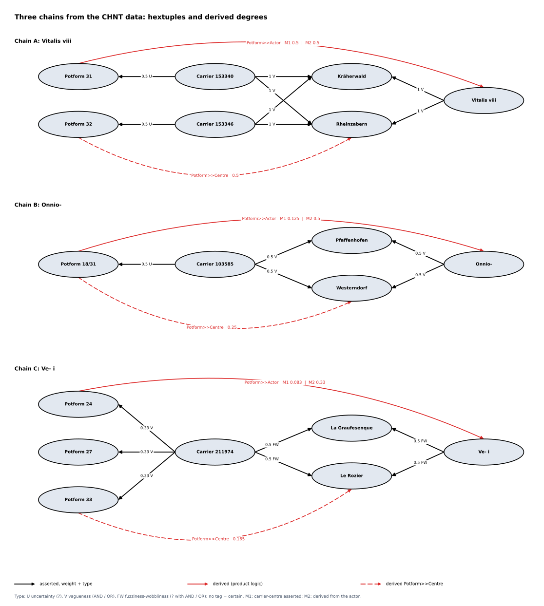

<!-- Generated by main.py (step: docs). Do not edit by hand; edit py/docs_text.py or ontology/mini-amt.ttl. -->

# Chains

Three chains from the CHNT data, one for each kind of imprecision, modelled as hextuples. The source strings
stand in [`data/chains-source.csv`](https://github.com/leiza-scit/CHNT2026-amt/blob/main/data/chains-source.csv); weight, FW type and method are computed
from them by `py/weights.py` (see [Weights](weights.html)). Two models are run over the same statements:

| Model | What is asserted | Carrier-centre link |
|---|---|---|
| M1 (the model of this repository) | `hasType`, `hasProductionCentre`, `worksAt` | asserted, as in the data export |
| M2 (`ontology/variant-b-derived.ttl`) | `hasType`, `createdBy` (crisp), `worksAt` | derived: `createdBy` o `worksAt` |

## The chains

| Chain | Carrier | Potter | Potform string | Centre string |
|---|---|---|---|---|
| A | 153346 | Vitalis viii | `32?` | `Kräherwald and Rheinzabern` |
| A | 153340 | Vitalis viii | `31?` | `Kräherwald and Rheinzabern` |
| B | 103585 | Onnio- | `18/31?` | `Pfaffenhofen or Westerndorf` |
| C | 211974 | Ve- i | `24 or 27 or 33` | `La Graufesenque and Le Rozier?` |

* **A** is vague without doubt: the potter worked at both centres (AND), the form is uncertain.
* **B** is an alternative: one centre or the other (OR), the form is uncertain.
* **C** combines both: three possible forms (OR) and two centres with a question mark (AND with `?`), which
  is fuzzy/wobbly.

Source: [PNG](diagrams/05_chains.png) · drawn by `py/step_diagrams.py` from the ontology.

## The hextuples of M1

| From | Role | To | Weight | FW type | Pattern | Expected on the relation |
|---|---|---|---|---|---|---|
| Carrier 103585 | `hasProductionCentre` | Pfaffenhofen | 0.5 | Vagueness | `or` | no |
| Carrier 103585 | `hasProductionCentre` | Westerndorf | 0.5 | Vagueness | `or` | no |
| Carrier 153340 | `hasProductionCentre` | Kräherwald | 1 | Vagueness | `and` | no |
| Carrier 153340 | `hasProductionCentre` | Rheinzabern | 1 | Vagueness | `and` | no |
| Carrier 153346 | `hasProductionCentre` | Kräherwald | 1 | Vagueness | `and` | no |
| Carrier 153346 | `hasProductionCentre` | Rheinzabern | 1 | Vagueness | `and` | no |
| Carrier 211974 | `hasProductionCentre` | La Graufesenque | 0.5 | FuzzinessWobbliness | `q+and` | no |
| Carrier 211974 | `hasProductionCentre` | Le Rozier | 0.5 | FuzzinessWobbliness | `q+and` | no |
| Carrier 103585 | `hasType` | Potform 18/31 | 0.5 | Uncertainty | `q` | yes |
| Carrier 153340 | `hasType` | Potform 31 | 0.5 | Uncertainty | `q` | yes |
| Carrier 153346 | `hasType` | Potform 32 | 0.5 | Uncertainty | `q` | yes |
| Carrier 211974 | `hasType` | Potform 24 | 0.33 | Vagueness | `or` | yes |
| Carrier 211974 | `hasType` | Potform 27 | 0.33 | Vagueness | `or` | yes |
| Carrier 211974 | `hasType` | Potform 33 | 0.33 | Vagueness | `or` | yes |
| Onnio- | `worksAt` | Pfaffenhofen | 0.5 | Vagueness | `or` | yes |
| Onnio- | `worksAt` | Westerndorf | 0.5 | Vagueness | `or` | yes |
| Ve- i | `worksAt` | La Graufesenque | 0.5 | FuzzinessWobbliness | `q+and` | yes |
| Ve- i | `worksAt` | Le Rozier | 0.5 | FuzzinessWobbliness | `q+and` | yes |
| Vitalis viii | `worksAt` | Kräherwald | 1 | Vagueness | `and` | yes |
| Vitalis viii | `worksAt` | Rheinzabern | 1 | Vagueness | `and` | yes |

The generated file is `dist/chains.ttl`; `dist/chains-with-model.ttl` adds the ontology and can be run with
the [AMT runner](https://github.com/alpaca-fair-framework/amt-runner) (`python run_amt.py dist/chains-with-model.ttl`).
The carrier-centre statements are inherited from the potter: they carry the same weight and type as the
potter-centre statements, and AND or OR is not in the list for that relation (see question 11 of the
[Review](review.html)).

## Derived degrees

Product is the logic of the ontology; Goedel is the minimum. M2 has no `carrierToActor`: the carrier-actor
link is asserted there (`createdBy`, 1.0), which is what the last column shows for it.

| Derived role | From | To | M1 product | M1 Goedel | M2 product |
|---|---|---|---|---|---|
| `carrierToActor` | Carrier 103585 | Onnio- | 0.250 | 0.500 | 1.000 |
| `carrierToActor` | Carrier 153340 | Vitalis viii | 1.000 | 1.000 | 1.000 |
| `carrierToActor` | Carrier 153346 | Vitalis viii | 1.000 | 1.000 | 1.000 |
| `carrierToActor` | Carrier 211974 | Ve- i | 0.250 | 0.500 | 1.000 |
| `potformToActor` | Potform 18/31 | Onnio- | 0.125 | 0.500 | 0.500 |
| `potformToActor` | Potform 24 | Ve- i | 0.083 | 0.330 | 0.330 |
| `potformToActor` | Potform 27 | Ve- i | 0.083 | 0.330 | 0.330 |
| `potformToActor` | Potform 31 | Vitalis viii | 0.500 | 0.500 | 0.500 |
| `potformToActor` | Potform 32 | Vitalis viii | 0.500 | 0.500 | 0.500 |
| `potformToActor` | Potform 33 | Ve- i | 0.083 | 0.330 | 0.330 |
| `potformToCentre` | Potform 18/31 | Pfaffenhofen | 0.250 | 0.500 | 0.250 |
| `potformToCentre` | Potform 18/31 | Westerndorf | 0.250 | 0.500 | 0.250 |
| `potformToCentre` | Potform 24 | La Graufesenque | 0.165 | 0.330 | 0.165 |
| `potformToCentre` | Potform 24 | Le Rozier | 0.165 | 0.330 | 0.165 |
| `potformToCentre` | Potform 27 | La Graufesenque | 0.165 | 0.330 | 0.165 |
| `potformToCentre` | Potform 27 | Le Rozier | 0.165 | 0.330 | 0.165 |
| `potformToCentre` | Potform 31 | Kräherwald | 0.500 | 0.500 | 0.500 |
| `potformToCentre` | Potform 31 | Rheinzabern | 0.500 | 0.500 | 0.500 |
| `potformToCentre` | Potform 32 | Kräherwald | 0.500 | 0.500 | 0.500 |
| `potformToCentre` | Potform 32 | Rheinzabern | 0.500 | 0.500 | 0.500 |
| `potformToCentre` | Potform 33 | La Graufesenque | 0.165 | 0.330 | 0.165 |
| `potformToCentre` | Potform 33 | Le Rozier | 0.165 | 0.330 | 0.165 |
| `carrierToCentre` | Carrier 103585 | Pfaffenhofen | 0.500 | 0.500 | 0.500 |
| `carrierToCentre` | Carrier 103585 | Westerndorf | 0.500 | 0.500 | 0.500 |
| `carrierToCentre` | Carrier 153340 | Kräherwald | 1.000 | 1.000 | 1.000 |
| `carrierToCentre` | Carrier 153340 | Rheinzabern | 1.000 | 1.000 | 1.000 |
| `carrierToCentre` | Carrier 153346 | Kräherwald | 1.000 | 1.000 | 1.000 |
| `carrierToCentre` | Carrier 153346 | Rheinzabern | 1.000 | 1.000 | 1.000 |
| `carrierToCentre` | Carrier 211974 | La Graufesenque | 0.500 | 0.500 | 0.500 |
| `carrierToCentre` | Carrier 211974 | Le Rozier | 0.500 | 0.500 | 0.500 |

Reading the table:

* Where the doubt sits only at the potter (chain C, `carrierToActor`), M1 under product counts it twice,
  once on the carrier-centre statement and once on the actor-centre statement. M1 under Goedel and M2 do not.
* `potformToCentre` is the same in M1 and M2 under product: the form and the centre are two independent doubts.
* `potformToActor` is the weakest degree under M1 and product in chains B and C, because the same centre doubt is passed twice.
