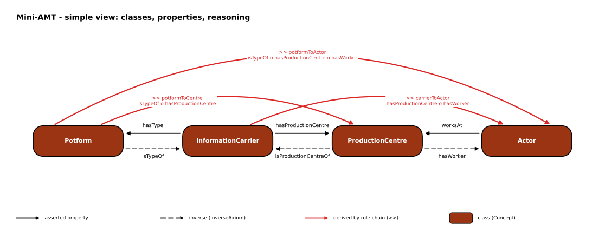
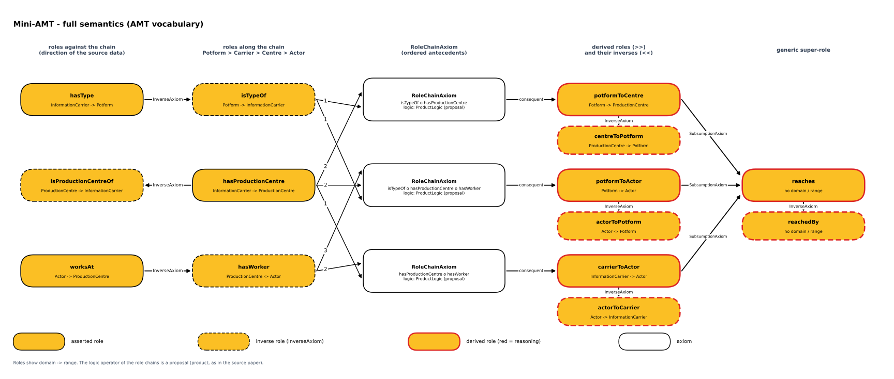

<!-- Generated by main.py (step: docs). Do not edit by hand; edit py/docs_text.py or ontology/mini-amt.ttl. -->

# Model

## Concepts

| Concept | Meaning |
|---|---|
| `Actor` | Person working at a production centre (the source model's ActorEntity and Actor are collapsed here). |
| `InformationCarrier` | The object carrying the information (e.g. a stamped vessel or sherd). |
| `Potform` | Vessel form or type (the typological class of an information carrier). |
| `ProductionCentre` | Place of production (e.g. a kiln site). |

## Simple view

Classes in dark orange. Black arrows are the asserted properties, dashed black arrows their inverses.
Red arcs are the links the reasoner derives from the role chains.

Source: [PNG](diagrams/01_simple_model.png) · drawn by `py/step_diagrams.py` from the ontology.

## Full semantics

The same model in the AMT vocabulary. Amber pills are roles (domain to range). White boxes are axioms.
A dashed outline marks a role that exists only as the inverse of another role; a red outline marks a
role that is derived by reasoning.

Source: [PNG](diagrams/02_full_semantics.png) · drawn by `py/step_diagrams.py` from the ontology.

Read it from the left: the asserted roles and their inverses; the role chains that compose the roles
along the chain direction (the numbers give the order of the antecedents); the derived roles with
their inverses; and the generic role `reaches` that subsumes all three.
