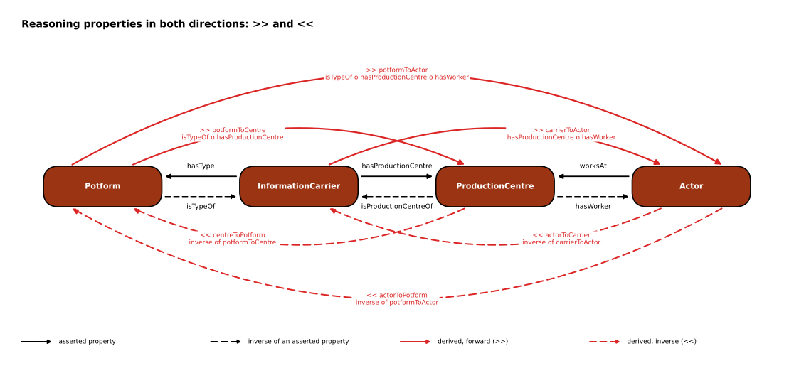
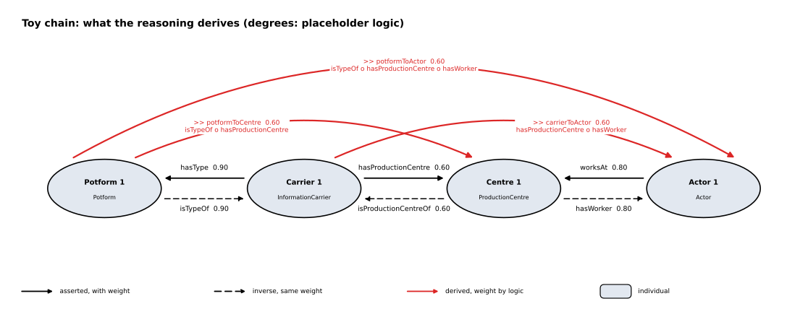

<!-- Generated by main.py (step: docs). Do not edit by hand; edit py/docs_text.py or ontology/mini-amt.ttl. -->

# Reasoning

## Why inverses are needed

AMT composes edges head to tail: the target of one edge must be the source of the next. The
chain runs Potform, InformationCarrier, ProductionCentre, Actor. Of the three links that the source
data asserts, only one points along that chain:

| Asserted role | Points | Along the chain? |
|---|---|---|
| `hasType` | InformationCarrier to Potform | no, against it |
| `hasProductionCentre` | InformationCarrier to ProductionCentre | yes |
| `worksAt` | Actor to ProductionCentre | no, against it |

Without inverses nothing composes: the first rule starts at a Potform, but no asserted edge leaves a
Potform. `hasType` therefore gets its inverse `isTypeOf` (agreed with Allard Mees), and `worksAt` gets
`hasWorker`. Every rule uses at least one inverse. The derived roles get inverses too, so that an
association can be asked from either end: "which centres go with this potform?" and "which potforms
go with this centre?".

## Reasoning properties, read from both ends

The three derived roles ("`>>`") and their inverses ("`<<`"). *Associated with* always means connected
through the chain, nothing more.

| Forward (`>>`) | Reads as | Inverse (`<<`) | Reads as |
|---|---|---|---|
| `carrierToActor` | The information carrier is associated with the actor: the carrier is attributed to a centre at which the actor worked. | `actorToCarrier` | The actor is associated with the information carrier: the actor worked at the centre to which the carrier is attributed. |
| `potformToCentre` | The potform is associated with the production centre: a carrier of this type is attributed to that centre. | `centreToPotform` | The production centre is associated with the potform: a carrier attributed to the centre is of this type. |
| `potformToActor` | The potform is associated with the actor: a carrier of this type is attributed to a centre at which the actor worked. | `actorToPotform` | The actor is associated with the potform: the forms attested at the centre where the actor worked. |

The limits, role by role:

| Role | Limit (what it does not say) |
|---|---|
| `carrierToActor` | A shared-centre association, not an attribution of authorship. The time intervals of carrier and actor are not compared. |
| `actorToCarrier` | Candidate carriers of the actor, not carriers the actor is known to have made. |
| `potformToCentre` | An association through at least one carrier. It does not say that the centre produced all, or most, carriers of the potform. |
| `centreToPotform` | Read from the centre, this is its attested range of forms as far as carriers are attributed to it. It is neither complete nor proportional. |
| `potformToActor` | The weakest of the three associations: three steps, two of them through the same centre. It does not say that the actor produced this potform. |
| `actorToPotform` | A candidate repertoire of the actor, derived from the centre. It is not the actor's own repertoire. |

All three forward roles are subsumed by the generic role `reaches` (and `reachedBy` for the inverses),
so one query finds every derived association.

Source: [PNG](diagrams/04_reasoning_both.png) · drawn by `py/step_diagrams.py` from the ontology.

## A worked chain

One abstract individual per concept. Only the three weighted edges of the source direction are asserted;
everything else below is derived. The weights are arbitrary placeholders, and the logic operator is
`GoedelLogic` (minimum) as a placeholder: the chain is as strong as its weakest link.

Source: [PNG](diagrams/03_toy_reasoning.png) · drawn by `py/step_diagrams.py` from the ontology.

| Edge | Weight | Source |
|---|---|---|
| `Carrier_1` --`hasProductionCentre`--> `Centre_1` | 0.60 | asserted |
| `Carrier_1` --`hasType`--> `Potform_1` | 0.90 | asserted |
| `Actor_1` --`worksAt`--> `Centre_1` | 0.80 | asserted |
| `Centre_1` --`hasWorker`--> `Actor_1` | 0.80 | `INV_worksAt` |
| `Centre_1` --`isProductionCentreOf`--> `Carrier_1` | 0.60 | `INV_hasProductionCentre` |
| `Potform_1` --`isTypeOf`--> `Carrier_1` | 0.90 | `INV_hasType` |
| `Carrier_1` --`carrierToActor`--> `Actor_1` | 0.60 | `RCA_carrierToActor` |
| `Potform_1` --`potformToActor`--> `Actor_1` | 0.60 | `RCA_potformToActor` |
| `Potform_1` --`potformToCentre`--> `Centre_1` | 0.60 | `RCA_potformToCentre` |
| `Actor_1` --`actorToCarrier`--> `Carrier_1` | 0.60 | `INV_carrierToActor` |
| `Actor_1` --`actorToPotform`--> `Potform_1` | 0.60 | `INV_potformToActor` |
| `Centre_1` --`centreToPotform`--> `Potform_1` | 0.60 | `INV_potformToCentre` |
| `Carrier_1` --`reaches`--> `Actor_1` | 0.60 | `SUB_carrierToActor` |
| `Potform_1` --`reaches`--> `Actor_1` | 0.60 | `SUB_potformToActor` |
| `Potform_1` --`reaches`--> `Centre_1` | 0.60 | `SUB_potformToCentre` |
| `Actor_1` --`reachedBy`--> `Carrier_1` | 0.60 | `INV_reaches` |
| `Actor_1` --`reachedBy`--> `Potform_1` | 0.60 | `INV_reaches` |
| `Centre_1` --`reachedBy`--> `Potform_1` | 0.60 | `INV_reaches` |

## What the reasoning does and does not do

1. **An association, not an attribution.** `carrierToActor` says that the actor worked at the
   centre to which the carrier is attributed. It does not say that the actor made the carrier. Both
   have time intervals in the source model; the chain does not compare them.
2. **Several paths keep the best one.** When more than one path leads to the same pair, AMT keeps the
   maximum weight. A potform with many carriers at one centre gets the weight of the best single
   carrier, not a weight that grows with the number of carriers.
3. **The third rule is written over the base roles.** `potformToActor` is `isTypeOf o hasProductionCentre
   o hasWorker`, not `potformToCentre o hasWorker`. For the associative operators (Goedel, Product,
   Einstein, Hamacher) both give the same degree; for the n-ary geometric mean they do not.
